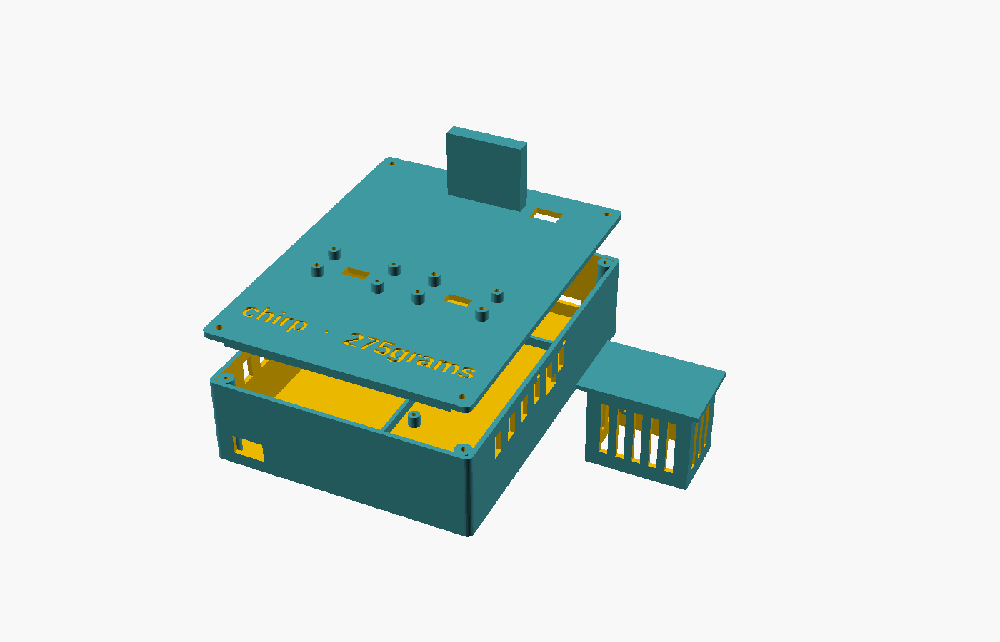

# Chirp

**Low-power listening stations that tell ecologists where bird species are thriving or declining, without shipping hours of audio (or anyone's voice) to the cloud.**

Team **275grams** · Junction 2026 hardware track · Arduino challenge: *Make Europe Green through Edge AI*



## The problem

Bird populations are a leading indicator of ecosystem health, but surveys are rare, manual and patchy. Acoustic monitoring helps, but recording continuously means storing and uploading huge amounts of audio, which costs power and bandwidth and captures people's conversations.

## What Chirp does

A Chirp station listens, identifies bird calls **on the device**, and sends only results to a dashboard:

- **Edge AI:** [BirdNET](https://github.com/birdnet-team/BirdNET-Analyzer) v2.4 runs on the Arduino UNO Q's Linux side, about 0.3 s per 3 s window (roughly 10× faster than real time).
- **Privacy by design:** only *accepted bird detections* keep audio, as a 3 s evidence clip. Windows where human speech is the top label are never accepted, stored or uploaded.
- **Real-time feedback on the board:** the MCU shows a glyph on the LED matrix and chirps the Modulino Buzzer for each detection. The Modulino Thermo logs air temperature with every window, and the Modulino Knob sets a power-saving duty cycle.
- **A dashboard for ecologists:** a map of stations coloured by detections per listening hour, a species filter, playable evidence clips, weekly trends, early-warning alerts for declines, online/offline status, and Darwin Core CSV export ready for GBIF and Laji.fi (FinBIF).

```
 Station (Arduino UNO Q)                                         Laptop
┌────────────────────────────────────────────────────┐        ┌───────────────────────────────┐
│ camera mic ─► Linux: 3 s windows ─► BirdNET v2.4   │  HTTP  │ FastAPI + SQLite              │
│              Finnish-species filter, drop speech   │ ─────► │ windows, detections, clips    │
│                     │ Bridge RPC                   │        │ map · trends · alerts · export│
│                     ▼                              │        └───────────────────────────────┘
│ MCU: LED matrix · Buzzer · Thermo · Knob           │
└────────────────────────────────────────────────────┘
```

## Honest by design

These rules are built into the data model and the UI, not just stated:

- The metric is **detections per valid listening hour**. Every analysed window is uploaded, with or without a detection, so listening effort is measured.
- **No listening means "no data", never zero activity.** Areas between stations are labelled **unsampled**.
- Detections are counted as **detection-minutes**. They're not individual animals.
- An alert is a **change in detected activity worth investigating**, not confirmed population loss. It needs a ≥ 30 % drop, enough listening time and a Poisson test at p < 0.01.
- **Synthetic data is always labelled.** The two simulated stations and their 12 weeks of history exist to demonstrate trends and alerts.
- **Model confidence is not accuracy.** Every detection keeps its clip, so a person can check it.

## Measured results (controlled tests, not field accuracy)

| What | Result |
|---|---|
| Inference on the UNO Q | 0.26–0.32 s per 3 s window, 2 threads |
| Phone speaker at ~30 cm, reference calls | Willow Tit 0.99 / 0.93, Great Tit 0.99, Goldcrest 0.83 / 0.84, Great Spotted Woodpecker 0.90 |
| Non-Finnish or non-bird labels (e.g. "Power tools", "Brown Rock Chat") | Logged as `unlisted`, never counted |
| End-to-end evidence | Detection → 3 s WAV (288 044 bytes) stored and playable on the dashboard |
| Mic gain | Camera mic at 20 % (+3.2 dB): no clipping on room noise. The 100 % default clips. |

## Quick start

**Laptop backend and dashboard** (Python 3.10+), from the repo root:

```sh
python -m pip install -r dashboard/requirements.txt
python -m dashboard.seed_simulated          # optional: labelled synthetic history for trends and alerts
python -m uvicorn dashboard.server:app --host 0.0.0.0 --port 8000
```

Open http://127.0.0.1:8000/. The station grid works without a Google Maps key. For the Google basemap (Street, or Satellite with 3D tilt), copy `dashboard/static/maps-config.js` to `maps-config.local.js` (gitignored) and paste a browser-restricted Maps JavaScript API key into the copy.

**Station (Arduino UNO Q)**, over SSH:

```sh
git clone <this repo> ~/repo
ln -s ~/repo/unoq-app ~/ArduinoApps/chirp-station
mkdir -p ~/repo/unoq-app/models/birdnet     # copy BirdNET_GLOBAL_6K_V2.4_{Labels.txt,Model_FP32.tflite} here
echo http://<laptop-ip>:8000 > ~/repo/unoq-app/python/server_url.txt
arduino-app-cli app start user:chirp-station
arduino-app-cli app logs user:chirp-station --tail 40
```

Plug the USB camera into the powered USB-C hub and the Modulinos into the Qwiic port. To make Chirp start on boot, run `arduino-app-cli properties set default user:chirp-station`. To update the station: `cd ~/repo; git pull`, then stop and start the app.

## Repository layout

| Path | What |
|---|---|
| [`unoq-app/`](unoq-app/) | App Lab app: `python/` (Linux side: capture, BirdNET, filtering, upload) and `sketch/` (MCU side: LED matrix, Modulinos) |
| [`dashboard/`](dashboard/) | Laptop backend (FastAPI, SQLite, evidence clips), map and statistics pages, synthetic-data seeder |
| [`protocol/http.md`](protocol/http.md) | The station ↔ backend contract, including rate and alert definitions |
| [`hardware/`](hardware/) | Bill of materials, wiring, and the parametric 3D-printed enclosure (OpenSCAD + STL) |
| [`docs/`](docs/) | Demo script and implementation plan |

## Limitations and next steps

- One real station so far. The others on the map are labelled simulations.
- Accuracy figures come from a phone speaker indoors, not from field validation.
- Long-run memory use and battery life aren't measured yet.
- **Next:** cheap satellite microphone nodes around each UNO Q, same-season baselines from multi-year data (so migration isn't mistaken for decline), and human review states for detections.

## Credits and licence

Chirp's own code, firmware and enclosure design are released under the [MIT licence](LICENSE).

Species identification uses **BirdNET** (BirdNET-Analyzer, model `BirdNET_GLOBAL_6K_V2.4`) by the K. Lisa Yang Center for Conservation Bioacoustics at the Cornell Lab of Ornithology and Chemnitz University of Technology. The model is licensed under [CC BY-NC-SA 4.0](https://creativecommons.org/licenses/by-nc-sa/4.0/): non-commercial use only, with attribution, and adaptations shared alike. The model files aren't in this repository; they are copied onto the board by hand.

Kahl, S., Wood, C. M., Eibl, M., & Klinck, H. (2021). BirdNET: A deep learning solution for avian diversity monitoring. *Ecological Informatics*, 61, 101236.

The LED-matrix bird flapping on each detection is the flight cycle of [Lil' Birb](https://casual-garage-coder.itch.io/lil-birb) by casual-garage-coder (CC0).

Project brief: [Project_Chirp (Google Doc)](https://docs.google.com/document/d/1t4BtwcmLkrue99UclOt9XjlUw0V_pBga41g4tzjcazQ/edit?usp=sharing).
